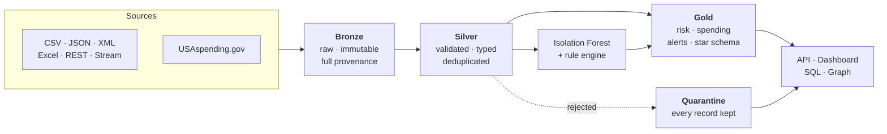

# Financial Intelligence Lakehouse

**An enterprise-style data engineering platform for financial oversight, anomaly
detection, data quality and multi-source lakehouse analytics.**

[](.github/workflows/ci.yml)


```bash
git clone <repo> && cd financial-intelligence-lakehouse
python -m venv .venv && source .venv/bin/activate     # Windows: .\.venv\Scripts\Activate.ps1
pip install -r requirements.txt
cp .env.example .env

python scripts/run_demo.py          # ~70 seconds, no containers required
streamlit run dashboard/app.py      # http://localhost:8501
```

No database, no broker, no cloud account, no network. Optional PostgreSQL, Neo4j
and Spark upgrade the experience but nothing depends on them.

---

## The problem

A financial oversight organisation receives spending data from many agencies,
vendors and financial systems. The feeds disagree about format, naming, typing
and quality. Some arrive as files, some over HTTP, some as a stream. None of
them are clean.

The platform turns that into something an analyst can trust: one validated
history of transactions, the bad records visibly set aside rather than silently
dropped, risk assessments that can be explained to a committee, and enough
metadata that any number on a dashboard traces back to the file it came from.

## What it does



| | |
| --- | --- |
| **Ingests** | CSV, JSON, XML, Excel, REST, NDJSON stream, plus the live USAspending API |
| **Validates** | 13 error codes, record-level, nothing ever dropped |
| **Scores quality** | 6 weighted dimensions, per run, published into the lake |
| **Detects** | Unsupervised anomalies + 8 explainable rules |
| **Serves** | 15 API endpoints, 7 dashboard pages, 53 SQL queries, 5 graph queries |
| **Records** | Every run, stage, check, lineage edge and model version |

---

## Results from a real run

Default scale, measured — not illustrative:

```
Transactions ingested:       63,891      (3 overlapping feeds)
Silver records:              56,805
Quarantined:                  7,086      across 9 error codes

Anomalies (model):              638
High risk:                      309
Critical risk:                    7
Open alerts:                    316

High-risk accounts:               3      of 1,971
High-risk vendors:               19      of 510

Data quality:                94.22%
Pipeline duration:            15.1s
Pipeline status:            SUCCESS
```

A critical transaction, with the explanation the platform produced:

```
TXN-000000047558   score 90 [CRITICAL]   $9,800.00
  - Amount is 29.7x the account's prior average of $330
  - Vendor has only 4 prior transactions (threshold 5)
  - Transaction occurred outside the account's home region
  - ML anomaly detected (score 0.862)
  - Round amount of $9,800 sits just below the $10,000 review threshold
```

Every point in that score is attributable to a named rule. The engine asserts
that no score exists without an explanation.

---

## Architecture

| Layer | Contract | Detail |
| --- | --- | --- |
| **Bronze** | What the source actually sent | No cleaning. Full provenance. Idempotent via content-hash ledger. Schema-on-read |
| **Silver** | What we stand behind | Typed, validated, deduplicated, referentially consistent. Rejections quarantined with error codes |
| **Gold** | Answers, not data | Wide, denormalised, pre-aggregated — plus a conformed star schema with an SCD-2 vendor dimension |

**Control plane** (PostgreSQL, SQLite fallback): pipeline runs, quality results,
lineage edges, ingestion ledger, model registry, dataset catalogue.

**Two engines, one specification.** pandas by default — genuinely faster than
Spark at this size — and PySpark + Delta in a container for the production
shape. Both interpret the same declarative specs, and
`tests/test_engine_parity.py` asserts identical output.

Full detail: [`docs/architecture.md`](docs/architecture.md) ·
[`docs/architecture_decisions.md`](docs/architecture_decisions.md)

---

## Data quality

Validation and measurement are separated, because they answer different
questions. Validation asks *may this record proceed*; quality asks *is this
dataset getting worse*.

```
Completeness    91.19%     Validity       100.00%
Uniqueness     100.00%     Integrity      100.00%
Freshness      100.00%     Volume          54.31%
Overall         93.23%  [WARN]     19/20 checks passed
Platform (records-weighted across 7 datasets):  94.22%
```

Validity and integrity read 100% because everything violating them was
quarantined — that is enforcement working. Volume is the honest one: at small
daily counts the data genuinely is noisy, and the check says so rather than
being tuned until it agrees.

Defects are *injected deliberately* at configured rates, so expected quarantine
volume is known in advance and the framework can be tested rather than merely
exercised.

[`docs/data_quality.md`](docs/data_quality.md)

---

## Detection

Two mechanisms, deliberately, with their disagreement reported:

- **Isolation Forest** — unsupervised, because labelled fraud is scarce, late,
  and only covers what was already caught.
- **Rule engine** — 8 configured rules, every score decomposable into named
  rules with evidence.

Held-out performance at the default scale (7,270 transactions in the test
period, 53 labelled frauds, 0.73% base rate):

| Metric | Value |
| --- | --- |
| PR-AUC | 0.276 |
| ROC-AUC | 0.900 |
| Precision@10 | 0.70 |
| Precision@50 | 0.32 |
| Recall@500 | 0.70 |
| Lift@10 | 96x |

Seven of the ten highest-scored transactions are genuine fraud, against a base
rate below 1%. Accuracy is never reported — predicting "never fraud" would score
99.3% and detect nothing.

At the `small` profile the same code scores PR-AUC 0.041 with only 17 labelled
frauds in the window; both sets of numbers are in
[`docs/ml_methodology.md`](docs/ml_methodology.md), because the difference
between them is a lesson about sample size, not about the model.

Leakage is prevented three ways: strictly-prior-row features, chronological
splits, and labels held in a separate file with an assertion guarding the
feature list. [`docs/ml_methodology.md`](docs/ml_methodology.md)

---

## Performance

Measured by `scripts/benchmark.py`, written to `metadata/benchmarks.json`:

| Scale | Transactions | Total | Silver throughput |
| --- | --- | --- | --- |
| small | 10,100 | 27.5 s | 3,461 rec/s |
| default | 50,500 | 65.9 s | 4,759 rec/s |

**The partitioning finding.** The benchmark reported a metadata-only row count
running *slower* than a full table read — backwards, and worth chasing. The
cause was 573 daily partitions holding ~17 rows each. Switching to monthly:

| | Daily | Monthly |
| --- | --- | --- |
| Partitions | 573 | 20 |
| Full read | 467 ms | 27 ms (**17x**) |
| Test suite | 162 s | 86 s |

No logic changed — one configuration value. Size the partition, not the
calendar. [`docs/performance.md`](docs/performance.md)

---

## Try it

```bash
python scripts/run_demo.py --scale small        # ~30 s
python scripts/run_demo.py --external           # also call the live USAspending API
make benchmark                                  # measured performance
make test                                       # 317 tests
```

| Command | What you get |
| --- | --- |
| `streamlit run dashboard/app.py` | 7 pages: overview, financial, risk, quality, monitoring, investigation, graph |
| `uvicorn src.api.main:app --port 8000` | 15 endpoints, OpenAPI at `/docs` |
| `python -m src.analytics.run_sql` | 53 analytical queries over the lake |
| `python -m src.streaming.event_generator --events 500` | Emit events, then `make stream` |
| `docker compose up -d postgres neo4j` | Upgrade metadata and graph backends |

---

## Repository layout

```
src/
  core/           config, schemas, contracts, hashing, IO, logging, run context
  ingestion/      csv, json, xml, excel, rest, usaspending, resilient http
  bronze/         idempotent loader with content-hash ledger
  silver/         declarative specs, validation, dedup, quarantine
  data_quality/   checks, suites, weighted scoring, validator
  ml/             leakage-safe features, isolation forest, registry, evaluation
  risk/           8 configured rules, explainable engine
  gold/           risk profiles, spending, alerts, quality, star schema
  graph/          neo4j client, loader, cypher + networkx fallback
  streaming/      event simulator, micro-batch pipeline, checkpoint
  engines/        pandas and spark implementations
  metadata/       store, lineage
  analytics/      duckdb engine, sql runner
  api/            fastapi serving layer
  pipelines/      batch, streaming, spark
dashboard/        7-page streamlit app
sql/              10 files, 53 queries
tests/            317 tests
docs/             12 documents
scripts/          demo, benchmark, schema export, doc generation, downloads
docker/           spark and app images, postgres init
```

---

## Documentation

| Document | Contents |
| --- | --- |
| [architecture.md](docs/architecture.md) | System design, layer contracts, dependency direction |
| [architecture_decisions.md](docs/architecture_decisions.md) | 15 decisions, including 3 revised after measurement |
| [data_quality.md](docs/data_quality.md) | Enforcement vs measurement, dimensions, calibration |
| [ml_methodology.md](docs/ml_methodology.md) | Leakage, temporal splits, honest metrics |
| [performance.md](docs/performance.md) | Measured numbers, the partitioning finding |
| [data_governance.md](docs/data_governance.md) | Ownership, contracts, lineage, retention, reproducibility |
| [data_dictionary.md](docs/data_dictionary.md) | Every field (generated) |
| [lineage.md](docs/lineage.md) | Every edge with row deltas (generated) |
| [graph_model.md](docs/graph_model.md) | Nodes, relationships, 5 Cypher queries |
| [databricks_deployment.md](docs/databricks_deployment.md) | Unity Catalog design and migration path |
| [kafka_optional.md](docs/kafka_optional.md) | The one-class diff to swap the transport |
| [data_sources.md](docs/data_sources.md) | Sources, licences, injected defects |
| [deployment.md](docs/deployment.md) | Setup, configuration, verification status |
| [interview_guide.md](docs/interview_guide.md) | 15 technical answers, stated limitations |

---

## Verification status

Built and verified on Windows 11, Python 3.14.5, pandas 3.0.5.

**Executed and verified here:** generation, 5-format ingestion, Bronze, Silver,
quality, ML, risk, Gold, streaming, SQL (53/53), API, all 7 dashboard pages, the
graph fallback, live USAspending calls, 317 tests, clean lint, benchmarks.

**Code-complete but not executed here:** the PySpark/Delta pipeline, PostgreSQL
metadata backend and Neo4j Cypher path. Docker's engine could not be started on
the build machine — its service requires elevation — so those tests skip. The
images build in CI. See [`docs/deployment.md`](docs/deployment.md#verification-status)
for exactly how to verify them.

Nothing in this repository claims to have run where it has not.

---

## Future improvements

1. Execute the Spark parity suite and Neo4j integration tests against live
   services, and record the measured numbers.
2. Supervised baseline against the unsupervised detector, once enough labels
   exist to make the comparison meaningful.
3. Graph-derived features (shared-vendor degree, component size) as model inputs
   — currently used for investigation only.
4. Alert threshold derived from reviewer capacity rather than a configured
   constant.
5. Drift-triggered retraining — the PSI check already detects the condition;
   nothing acts on it.
6. Incremental Silver by ingestion date instead of full rebuild, which is what
   the ingestion ledger already makes possible.

---

## Licence

MIT — see [LICENSE](LICENSE).

All data is synthetic. Every person, vendor, account and identifier is
fictional. USAspending data is US Government work in the public domain.
