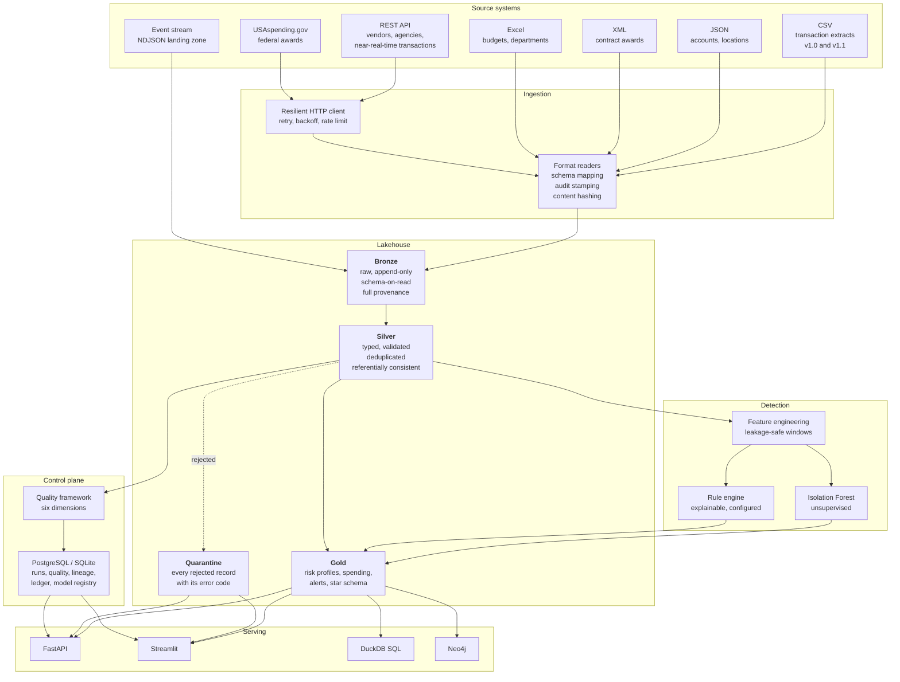
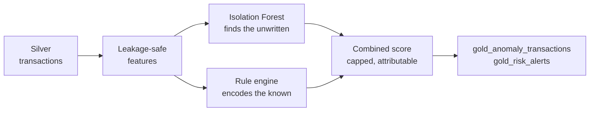

# Architecture

## The problem

A financial oversight organisation receives spending data from many agencies,
vendors and financial systems. The feeds disagree about format, naming, typing
and quality. Some arrive as files on a schedule, some over HTTP, some as a
stream. None of them are clean.

The platform has to turn that into something an analyst can trust: a single
validated history of transactions, with the bad records visibly set aside rather
than silently dropped, risk assessments that can be explained to a committee,
and enough metadata that any number on a dashboard can be traced back to the
file it came from.

## System overview



## The layers, and what each is for

### Bronze - what the source actually sent

Bronze answers one question and answers it forever: *what did we receive?*

- **No cleaning, no casting, no filtering.** Values stay as text if they arrived
  as text, including the obviously wrong ones. A negative amount is preserved
  here and rejected in Silver. Deleting it at ingestion would destroy the
  evidence that an upstream system has a bug.
- **Provenance on every row** - source system, file, format, ingestion run,
  content hash, schema version, row number.
- **Idempotent.** Every source unit carries a content hash, checked against an
  ingestion ledger before writing. Re-running a load is a no-op; a file re-sent
  with *new* content under the same name is correctly treated as new data.
- **Schema-on-read.** New source columns are absorbed without a migration.

Because Bronze is complete and immutable, Silver and Gold are disposable: delete
them, re-run, and you get identical output.

### Silver - what we are prepared to stand behind

Silver takes a position on what the data means, and on what to do with the rest:

| Situation | Policy |
| --- | --- |
| Required field missing | Quarantine. A transaction with no account cannot be attributed. |
| Optional field missing | Keep the null. A null that means "unknown" is more honest than a zero that looks like data. |
| Invalid value | Quarantine with a specific error code. |
| Broken blocking foreign key | Quarantine (`UNKNOWN_ACCOUNT`, `UNKNOWN_VENDOR`). |
| Broken non-blocking foreign key | Null the reference, keep the record. Petty-cash spend legitimately has no contract. |
| Duplicate | Collapse to one deterministic survivor; the losers go to quarantine. |

Nothing is ever silently dropped.

### Gold - answers, not data

Gold datasets map one-to-one onto questions an oversight analyst asks. They are
wide, denormalised and pre-aggregated: a dashboard should read one table, not
join five. A conformed star schema is published alongside for the
BI-tool-and-unanticipated-question case.

## Deduplication: two different problems

Conflating these is a common source of silent data loss.

**Same identifier, re-sent.** A replayed file or an at-least-once queue.
Collapsed on the business key.

**Different identifier, same content.** A source re-issues the same payment
under a new reference. The business key cannot see this. The content hash can,
because it is computed over account, vendor, amount, currency and timestamp -
deliberately *excluding* the transaction id.

Both are handled, both are recorded, and the survivor is chosen by a total
ordering so that two runs over identical input keep the same row.

## Detection: two mechanisms, on purpose



Isolation Forest finds patterns nobody wrote down but cannot explain itself.
Rules are auditable line by line but only find what someone thought to write.
Running both, and reporting where they disagree, is more useful than either -
the model-only population is where genuinely novel patterns show up, or where
the model has drifted.

Every risk score is decomposable. A transaction scoring 65 carries the list of
rules that fired and the evidence for each ("Amount is 12.4x the account's prior
average of $1,204"). The engine asserts that no score exists without an
explanation.

## Control plane

Operational metadata does not live in the lake. Parquet is excellent for
analytical data and poor for small, frequently-updated, transactional records -
which is exactly what pipeline runs, quality results and lineage edges are.

| Store | Holds | Why |
| --- | --- | --- |
| PostgreSQL (SQLite fallback) | runs, stages, quality results, lineage, ingestion ledger, model registry, catalogue | Small rows, written constantly, read transactionally |
| Parquet lake | Bronze, Silver, Gold, quarantine | Large, append-mostly, scanned analytically |
| DuckDB | Analytical SQL over the lake, in place | Columnar and vectorised; no copy, so nothing goes stale |
| Neo4j (optional) | Relationship investigation | Variable-depth traversal that SQL expresses badly |

The metadata store never raises into a pipeline. If it is unavailable the run
continues and the failure is logged - observability matters, but not more than
the data.

## Engines

The same declarative specifications are executed by two engines:

- **pandas** (default) - runs anywhere, no JVM. At the volumes this project runs
  locally it is genuinely faster than Spark; Spark's scheduling overhead
  dominates until data no longer fits in memory.
- **PySpark + Delta** (containerised) - the production shape, and what maps onto
  Databricks. Runs in Docker because PySpark needs a JVM and supports Python
  ≤ 3.12.

They are two interpreters of one specification, not a shared codebase with a
switch. `tests/test_engine_parity.py` runs both over identical input and asserts
identical output, because otherwise the claim would be decoration.

## Streaming

File-based landing zone, processed in micro-batches. This is a real streaming
pattern - cloud object-store autoloading works the same way - and it exercises
the concerns that matter: exactly-once file handling via a content-hash
checkpoint, event time versus processing time, watermarked late arrivals, and
bounded state for velocity tracking.

Late events are **marked and kept**, never discarded. The watermark bounds how
long state stays open, not what the platform accepts: a payment that arrives
late is still a payment.

Streaming scores against a **feature store** (the Gold risk tables, refreshed by
the batch pipeline) rather than recomputing history per event. Without that, the
history-dependent rules fire on everything - which they did, until measurement
showed one alert per event and no signal at all.

## Dependency direction

```
core  <-  ingestion  <-  bronze  <-  silver  <-  gold  <-  serving
  ^                                     |
  +---- metadata, data_quality ---------+
```

`src.core` imports from nothing above it, so configuration, hashing, schemas and
IO stay testable in isolation. Layers import downward only.

## Related documents

- [`architecture_decisions.md`](architecture_decisions.md) - why each choice, and what was rejected
- [`data_quality.md`](data_quality.md) - the six dimensions and how they are scored
- [`ml_methodology.md`](ml_methodology.md) - leakage, temporal splits, honest metrics
- [`performance.md`](performance.md) - measured numbers and what was optimised
- [`databricks_deployment.md`](databricks_deployment.md) - what changes to run this on Databricks
