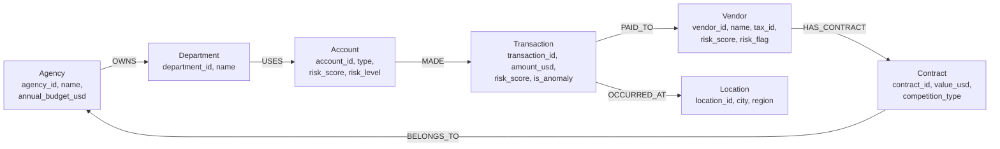

# Graph Model

## Why a graph at all

Most questions in this platform are aggregations, and SQL answers them better
than a graph would. The graph earns its place on one class of question:
**variable-depth relationship traversal**.

```cypher
MATCH path = (v:Vendor {vendor_id: $id})-[*1..3]-(connected)
RETURN connected, length(path)
```

The SQL equivalent is a recursive CTE that nobody enjoys reading or tuning. The
rule this project follows:

| Question shape | Where it belongs |
| --- | --- |
| Fixed-depth joins ("accounts sharing a vendor") | SQL — `sql/10_graph_investigation.sql` |
| Aggregation, ranking, time series | SQL |
| Variable-depth traversal, path finding, component detection | Cypher |

Both implementations exist for the fixed-depth questions specifically so the
comparison is visible rather than asserted.

## Node and relationship model



The cycle `Agency → Department → Account → Transaction → Vendor → Contract →
Agency` is deliberate: it is what makes "an agency's own account paying a vendor
that agency awarded a contract to" a single traversal.

### Risk on the nodes

Risk scores are written onto `Account` and `Vendor` nodes rather than derived at
query time, so Cypher can filter on them directly
(`WHERE v.risk_level = 'HIGH'`) instead of traversing to every transaction and
aggregating on each query.

## What gets loaded, and what does not

The graph duplicates data the lake already holds authoritatively, so loading
everything would make it a slow second copy of the fact table. The loader takes:

- **all risk-relevant transactions** (MEDIUM and above, or model-flagged), plus
- **a random sample of ordinary ones**, capped by `graph.max_transactions`.

The ordinary sample matters. Load only the flagged transactions and every
account in the graph appears to be 100% suspicious, which is worse than useless
for comparison.

## Idempotent loading

Every statement uses `MERGE`, never `CREATE`, and writes are batched with
`UNWIND`:

```cypher
UNWIND $rows AS row
MERGE (t:Transaction {transaction_id: row.transaction_id})
SET t.amount_usd = row.amount_usd, t.risk_score = row.risk_score
WITH t, row
MATCH (acc:Account {account_id: row.account_id})
MERGE (acc)-[:MADE]->(t)
```

A load that doubles the edges on re-run makes every degree-based metric silently
wrong. `tests/test_graph.py::test_load_is_idempotent` asserts the node count is
unchanged after a second load.

Uniqueness constraints are created for every node key. They are not only
correctness: each one creates a backing index, which is what makes
`MATCH (v:Vendor {vendor_id: $id})` a lookup rather than a scan.

Batching via `UNWIND` in chunks of 1,000 turns a 20,000-transaction load from
20,000 round trips into 20.

## The five investigation queries

### 1. Accounts sharing a vendor

```cypher
MATCH (a1:Account)-[:MADE]->(t1:Transaction)-[:PAID_TO]->(v:Vendor),
      (a2:Account)-[:MADE]->(t2:Transaction)-[:PAID_TO]->(v)
WHERE a1.account_id < a2.account_id
RETURN a1.account_id, a2.account_id, v.vendor_id, count(DISTINCT t1) AS payments
ORDER BY payments DESC
```

Not suspicious in itself — shared suppliers are normal — but it is the structure
fraud rings use, and the starting point for expanding an investigation. The
`a1 < a2` predicate stops each pair appearing twice and stops an account pairing
with itself.

### 2. Vendors linked to multiple high-risk accounts

The headline question. Vendors receiving money from several accounts that were
*independently* scored as high risk:

```cypher
MATCH (a:Account)-[:MADE]->(t:Transaction)-[:PAID_TO]->(v:Vendor)
WHERE a.risk_level IN ['HIGH', 'CRITICAL']
WITH v, collect(DISTINCT a.account_id) AS accounts, sum(t.amount_usd) AS total
WHERE size(accounts) >= $min_accounts
RETURN v.vendor_id, v.name, size(accounts) AS high_risk_accounts, total
ORDER BY high_risk_accounts DESC
```

### 3. Vendor neighbourhood

Variable-depth expansion from one vendor — the query that justifies the graph:

```cypher
MATCH path = (v:Vendor {vendor_id: $vendor_id})-[*1..3]-(connected)
RETURN DISTINCT labels(connected)[0] AS node_type, connected, length(path) AS hops
ORDER BY hops
```

### 4. Award loops

An agency awards a contract to a vendor, and one of that agency's own accounts
makes flagged payments to the same vendor:

```cypher
MATCH (ag:Agency)-[:OWNS]->(:Department)-[:USES]->(acc:Account)
      -[:MADE]->(t:Transaction)-[:PAID_TO]->(v:Vendor)
      -[:HAS_CONTRACT]->(c:Contract)-[:BELONGS_TO]->(ag)
WHERE t.risk_level IN ['HIGH', 'CRITICAL']
RETURN ag.name, c.contract_id, c.competition_type, v.name, count(t), sum(t.amount_usd)
```

Proof of nothing on its own. It is a shape that warrants a look, especially
where `competition_type = 'SOLE_SOURCE'`.

### 5. Duplicate vendor registrations

```cypher
MATCH (v:Vendor) WHERE v.tax_id IS NOT NULL
WITH v.tax_id AS tax_id, collect(v) AS vendors
WHERE size(vendors) > 1
RETURN tax_id, size(vendors) AS registrations, [x IN vendors | x.name] AS names
```

The same legal entity registered under several vendor ids. The platform
**reports** these and never merges them: collapsing master data on a fuzzy signal
destroys the audit trail, so adjudication stays with a data steward.

## Graceful degradation

Every entry point works without Neo4j. When the database is unreachable, the
same five questions are answered in-process with NetworkX over the same Parquet
data, and the response says which backend produced it:

```json
{
  "backend": "networkx_fallback",
  "vendor_id": "VEN-000146",
  "node_count": 66,
  "note": "Computed in-process from Parquet because Neo4j is not reachable."
}
```

The fallback is honest about its limits: it builds a bounded in-memory graph
scoped to the question (only the accounts that touched the vendor in question,
not the whole dataset), so it answers the same questions on the same data but
would not scale to a graph that does not fit in memory. That is exactly why
Neo4j is the primary path.

The dashboard shows a plain notice rather than an error, and the pipeline treats
graph loading as an optional stage. A payments oversight platform must not stop
ingesting money movements because a graph database is down.

## Running it

```bash
docker compose up -d neo4j          # http://localhost:7474  (neo4j / fil_local_password)
make load-graph                     # load dimensions + a bounded transaction set
```

Then the **Graph Investigation** page in the dashboard, or:

```bash
curl "http://localhost:8000/graph/vendor/VEN-000146?depth=2"
```

## Status

The Neo4j client, loader, Cypher library, constraints, batched writes and
idempotent `MERGE` semantics are implemented, and the integration tests are
written and marked `neo4j`.

**They have not been executed against a live Neo4j instance in this
environment** — Docker's engine could not be started on the build machine (see
[`deployment.md`](deployment.md)). The tests skip automatically when no instance
is reachable, and everything demonstrated in the dashboard and API so far ran
through the NetworkX fallback, which is what the `backend` field in every
response reports.
