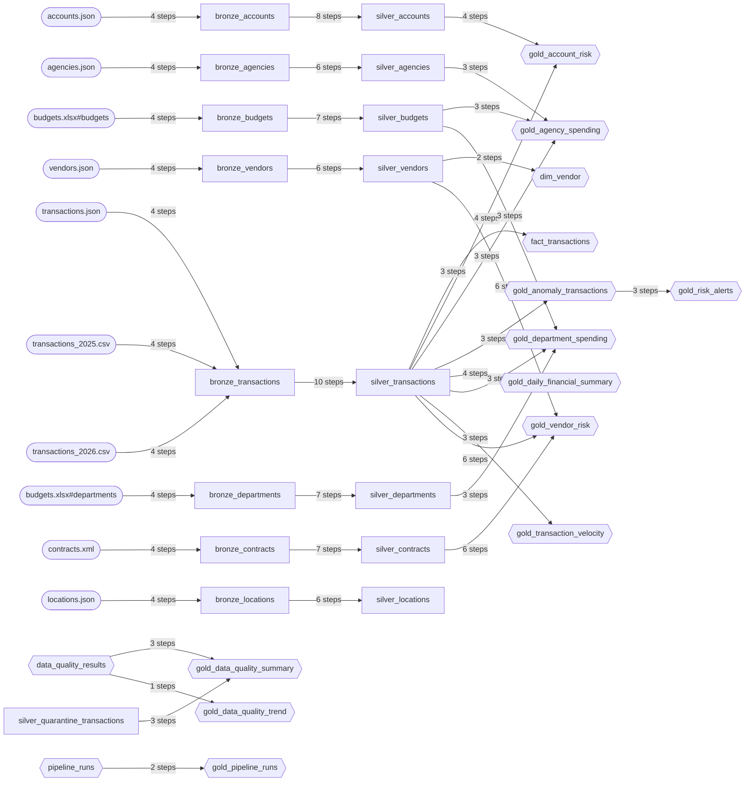

# Data Lineage

> **Generated file.** Produced by `python scripts/generate_docs.py` from `metadata/lineage.json`, which the pipelines emit as they run.

Lineage here is **emitted by the code that performs each transformation**, not reconstructed by parsing SQL afterwards. Each edge records the transformations applied and the row counts on both sides, so the number of records lost between any two datasets is a fact rather than an inference.

Captured from run `20260816T025758-faa81a` at 2026-08-16T02:58:07+00:00 - 39 edges.

## Flow

## Edges

### `bronze_accounts`

**From `accounts.json`**

- Records: 500 in -> 500 out
- Transformations:
  - `schema_mapping`
  - `audit_stamping`
  - `content_hash`
  - `idempotency_check`

### `bronze_agencies`

**From `agencies.json`**

- Records: 20 in -> 20 out
- Transformations:
  - `schema_mapping`
  - `audit_stamping`
  - `content_hash`
  - `idempotency_check`

### `bronze_budgets`

**From `budgets.xlsx#budgets`**

- Records: 1,526 in -> 1,526 out
- Transformations:
  - `schema_mapping`
  - `audit_stamping`
  - `content_hash`
  - `idempotency_check`

### `bronze_contracts`

**From `contracts.xml`**

- Records: 400 in -> 400 out
- Transformations:
  - `schema_mapping`
  - `audit_stamping`
  - `content_hash`
  - `idempotency_check`

### `bronze_departments`

**From `budgets.xlsx#departments`**

- Records: 109 in -> 109 out
- Transformations:
  - `schema_mapping`
  - `audit_stamping`
  - `content_hash`
  - `idempotency_check`

### `bronze_locations`

**From `locations.json`**

- Records: 36 in -> 36 out
- Transformations:
  - `schema_mapping`
  - `audit_stamping`
  - `content_hash`
  - `idempotency_check`

### `bronze_transactions`

**From `transactions.json`**

- Records: 1,010 in -> 11,110 out
- Transformations:
  - `schema_mapping`
  - `audit_stamping`
  - `content_hash`
  - `idempotency_check`

**From `transactions_2025.csv`**

- Records: 6,512 in -> 11,110 out
- Transformations:
  - `schema_mapping`
  - `audit_stamping`
  - `content_hash`
  - `idempotency_check`

**From `transactions_2026.csv`**

- Records: 3,588 in -> 11,110 out
- Transformations:
  - `schema_mapping`
  - `audit_stamping`
  - `content_hash`
  - `idempotency_check`

### `bronze_vendors`

**From `vendors.json`**

- Records: 153 in -> 153 out
- Transformations:
  - `schema_mapping`
  - `audit_stamping`
  - `content_hash`
  - `idempotency_check`

### `dim_vendor`

**From `silver_vendors`**

- Records: 0 in -> 153 out
- Transformations:
  - `scd_type_2`
  - `attribute_hash_change_detection`

### `fact_transactions`

**From `silver_transactions`**

- Records: 0 in -> 9,675 out
- Transformations:
  - `surrogate_key_generation`
  - `fact_narrowing`
  - `measure_selection`

### `gold_account_risk`

**From `silver_accounts`**

- Records: 9,675 in -> 481 out (9,194 dropped)
- Transformations:
  - `account_aggregation`
  - `behavioural_metrics`
  - `composite_risk_scoring`
  - `risk_banding`

**From `silver_transactions`**

- Records: 9,675 in -> 481 out (9,194 dropped)
- Transformations:
  - `account_aggregation`
  - `behavioural_metrics`
  - `composite_risk_scoring`
  - `risk_banding`

### `gold_agency_spending`

**From `silver_agencies`**

- Records: 9,675 in -> 40 out (9,635 dropped)
- Transformations:
  - `agency_aggregation`
  - `budget_join`
  - `vendor_concentration`

**From `silver_budgets`**

- Records: 9,675 in -> 40 out (9,635 dropped)
- Transformations:
  - `agency_aggregation`
  - `budget_join`
  - `vendor_concentration`

**From `silver_transactions`**

- Records: 9,675 in -> 40 out (9,635 dropped)
- Transformations:
  - `agency_aggregation`
  - `budget_join`
  - `vendor_concentration`

### `gold_anomaly_transactions`

**From `silver_transactions`**

- Records: 9,675 in -> 286 out (9,389 dropped)
- Transformations:
  - `anomaly_selection`
  - `risk_scoring`
  - `explanation_attachment`

### `gold_daily_financial_summary`

**From `silver_transactions`**

- Records: 9,675 in -> 573 out (9,102 dropped)
- Transformations:
  - `daily_aggregation`
  - `distribution_statistics`
  - `anomaly_counts`
  - `rolling_7d_baseline`

### `gold_data_quality_summary`

**From `data_quality_results`**

- Records: 0 in -> 7 out
- Transformations:
  - `latest_scorecard_selection`
  - `quarantine_join`
  - `rate_computation`

**From `silver_quarantine_transactions`**

- Records: 0 in -> 7 out
- Transformations:
  - `latest_scorecard_selection`
  - `quarantine_join`
  - `rate_computation`

### `gold_data_quality_trend`

**From `data_quality_results`**

- Records: 0 in -> 7 out
- Transformations:
  - `daily_quality_aggregation`

### `gold_department_spending`

**From `silver_budgets`**

- Records: 9,675 in -> 210 out (9,465 dropped)
- Transformations:
  - `department_aggregation`
  - `budget_join`
  - `overrun_detection`

**From `silver_departments`**

- Records: 9,675 in -> 210 out (9,465 dropped)
- Transformations:
  - `department_aggregation`
  - `budget_join`
  - `overrun_detection`

**From `silver_transactions`**

- Records: 9,675 in -> 210 out (9,465 dropped)
- Transformations:
  - `department_aggregation`
  - `budget_join`
  - `overrun_detection`

### `gold_pipeline_runs`

**From `pipeline_runs`**

- Records: 0 in -> 1 out
- Transformations:
  - `metadata_snapshot`
  - `throughput_computation`

### `gold_risk_alerts`

**From `gold_anomaly_transactions`**

- Records: 9,675 in -> 46 out (9,629 dropped)
- Transformations:
  - `alert_threshold_filter`
  - `deterministic_alert_id`
  - `case_lifecycle`

### `gold_transaction_velocity`

**From `silver_transactions`**

- Records: 9,675 in -> 9,554 out (121 dropped)
- Transformations:
  - `hourly_aggregation`
  - `velocity_computation`
  - `burst_detection`

### `gold_vendor_risk`

**From `silver_contracts`**

- Records: 9,675 in -> 153 out (9,522 dropped)
- Transformations:
  - `vendor_aggregation`
  - `payer_breadth`
  - `contract_coverage`
  - `growth_vs_baseline`
  - `duplicate_registration_detection`
  - `composite_risk_scoring`

**From `silver_transactions`**

- Records: 9,675 in -> 153 out (9,522 dropped)
- Transformations:
  - `vendor_aggregation`
  - `payer_breadth`
  - `contract_coverage`
  - `growth_vs_baseline`
  - `duplicate_registration_detection`
  - `composite_risk_scoring`

**From `silver_vendors`**

- Records: 9,675 in -> 153 out (9,522 dropped)
- Transformations:
  - `vendor_aggregation`
  - `payer_breadth`
  - `contract_coverage`
  - `growth_vs_baseline`
  - `duplicate_registration_detection`
  - `composite_risk_scoring`

### `silver_accounts`

**From `bronze_accounts`**

- Records: 500 in -> 500 out
- Transformations:
  - `schema_alignment`
  - `type_casting`
  - `string_normalisation`
  - `null_policy`
  - `currency_normalisation`
  - `deduplication`
  - `referential_integrity`
  - `quarantine_invalid_records`

### `silver_agencies`

**From `bronze_agencies`**

- Records: 20 in -> 20 out
- Transformations:
  - `schema_alignment`
  - `type_casting`
  - `string_normalisation`
  - `null_policy`
  - `deduplication`
  - `quarantine_invalid_records`

### `silver_budgets`

**From `bronze_budgets`**

- Records: 1,526 in -> 1,526 out
- Transformations:
  - `schema_alignment`
  - `type_casting`
  - `string_normalisation`
  - `null_policy`
  - `deduplication`
  - `referential_integrity`
  - `quarantine_invalid_records`

### `silver_contracts`

**From `bronze_contracts`**

- Records: 400 in -> 400 out
- Transformations:
  - `schema_alignment`
  - `type_casting`
  - `string_normalisation`
  - `null_policy`
  - `deduplication`
  - `referential_integrity`
  - `quarantine_invalid_records`

### `silver_departments`

**From `bronze_departments`**

- Records: 109 in -> 109 out
- Transformations:
  - `schema_alignment`
  - `type_casting`
  - `string_normalisation`
  - `null_policy`
  - `deduplication`
  - `referential_integrity`
  - `quarantine_invalid_records`

### `silver_locations`

**From `bronze_locations`**

- Records: 36 in -> 36 out
- Transformations:
  - `schema_alignment`
  - `type_casting`
  - `string_normalisation`
  - `null_policy`
  - `deduplication`
  - `quarantine_invalid_records`

### `silver_transactions`

**From `bronze_transactions`**

- Records: 11,110 in -> 9,675 out (1,435 dropped)
- Transformations:
  - `schema_alignment`
  - `type_casting`
  - `string_normalisation`
  - `null_policy`
  - `timestamp_parsing`
  - `currency_normalisation`
  - `deduplication`
  - `referential_integrity`
  - `derived_columns`
  - `quarantine_invalid_records`

### `silver_vendors`

**From `bronze_vendors`**

- Records: 153 in -> 153 out
- Transformations:
  - `schema_alignment`
  - `type_casting`
  - `string_normalisation`
  - `null_policy`
  - `deduplication`
  - `quarantine_invalid_records`

## Where records go

Records dropped between Bronze and Silver are **not deleted**. Every one is written to the quarantine dataset with its error code, the raw payload as received, the source file and the run that rejected it. `sql/05_data_quality.sql` reports them by error code and by source system.
